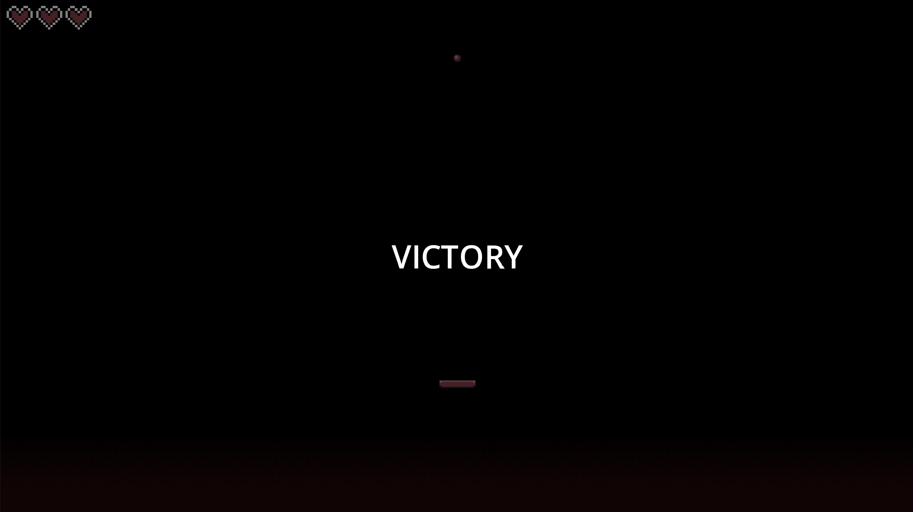

# Breakout

Petit clone de Breakout fait avec **Godot 4**, pour s'entraîner sur les bases du moteur : scènes, physique 2D, collisions, signaux, ressources, autoloads et interfaces.

## Screenshots

<p align="center">
  
</p>

<table align="center">
  <tr>
    <td align="center"><br><sub>Niveau</sub></td>
    <td align="center"><br><sub>Power-ups</sub></td>
    <td align="center"><br><sub>Sélection de niveau</sub></td>
  </tr>
  <tr>
    <td align="center"><br><sub>Choix du skin</sub></td>
    <td align="center"><br><sub>Victoire</sub></td>
    <td align="center"><br><sub>Défaite</sub></td>
  </tr>
</table>

## Fonctionnalités

- 5 niveaux de difficulté croissante, décrits en texte et construits automatiquement
- Écran de sélection de niveau avec une miniature générée de chaque niveau
- Rebond de la balle dont l'angle dépend du point d'impact sur le paddle
- Briques à plusieurs PV avec états de casse (plates, épaisses, carrées)
- Power-ups qui tombent des briques détruites
- Multi-balles : une vie n'est perdue que quand la dernière balle tombe
- Contrôle au clavier ou à la souris, au choix dans les paramètres
- Paramètres enregistrés entre deux sessions
- Menu principal, menu pause, écrans de victoire et de game over

## Contrôles

| Action | Mode clavier | Mode souris |
|---|---|---|
| Déplacer le paddle | ← / → | Souris |
| Lancer la balle | Espace | Clic gauche |
| Pause | Échap | Échap |

Le mode de contrôle se choisit dans les paramètres.

## Power-ups

| Symbole | Nom | Effet |
|---|---|---|
| L | Large | Agrandit le paddle |
| S | Small | Rétrécit le paddle (malus) |
| +1 | Multi-balles | La balle se divise en trois |
| ♥ | Vie | +1 vie (dans la limite du maximum) |
| ✦ | Feu | La balle traverse et détruit les briques d'un coup |

Chaque power-up est un fichier `.tres` : le script définit ce que fait l'effet, la ressource définit ses réglages (couleur, symbole, durée…).

## Structure

```
res://
├── autoload/          # singletons : PlayerState, SceneManager, Settings
├── game/              # scène de jeu : orchestre la partie (vies, victoire, power-ups)
├── arena/             # murs, paddle, zone de mort
├── entities/
│   ├── paddle/
│   ├── ball/          # balle + BallManager
│   ├── brick/
│   └── powerup/
│       └── effects/   # un script par comportement, un .tres par power-up
├── levels/
│   ├── maps/          # un niveau = un .tres décrivant la disposition des briques
│   ├── level_data.gd
│   ├── level_builder.gd
│   └── level_preview  # outil de visualisation des niveaux dans l'éditeur
├── ui/
│   ├── hud/
│   └── menus/         # menu principal, sélection de niveau, pause, paramètres, fins de partie
└── shared/            # sprites, sons, polices
```

## Roadmap

- [x] Paddle
- [x] Murs
- [x] Balle (rebond selon la position sur le paddle)
- [x] Briques
- [x] Premier niveau
- [x] Zone de mort + vies
- [ ] Score + HUD
- [x] Victoire / défaite
- [x] Power-ups
- [x] Menu de sélection de niveau / niveaux supplémentaires
- [x] Paramètres (mode de contrôle) enregistrés
- [ ] Choix de couleurs (paddle, balle, briques, fond)
- [ ] Sons, particules, screen shake
- [ ] Vérifier les membres privés (fonctions, variables)
- [ ] Améliorer l'UI
- [ ] Commenter le code
- [ ] Gestion des erreurs

## Lancer le projet

Ouvrir le dossier dans Godot 4 et lancer avec **F5**.
