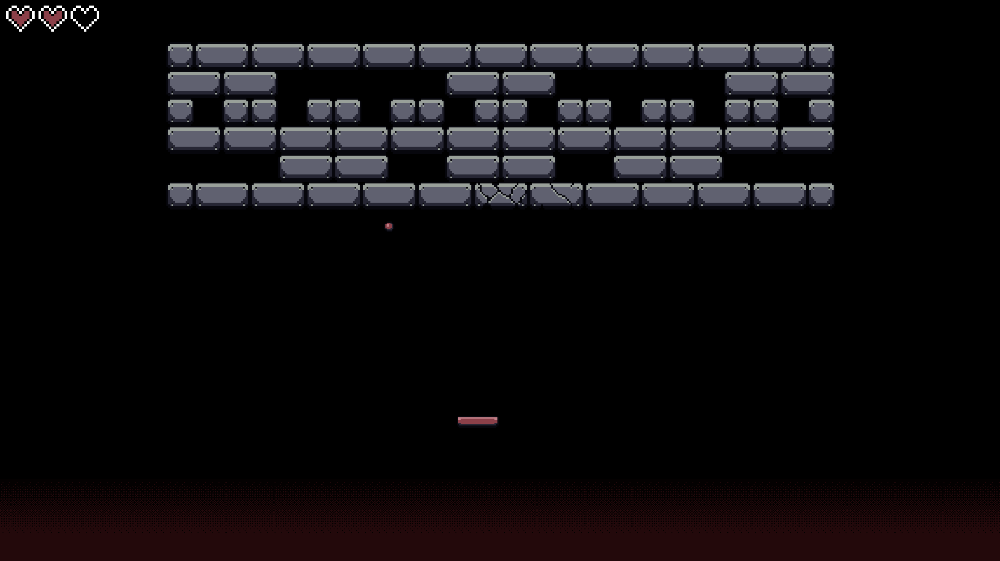
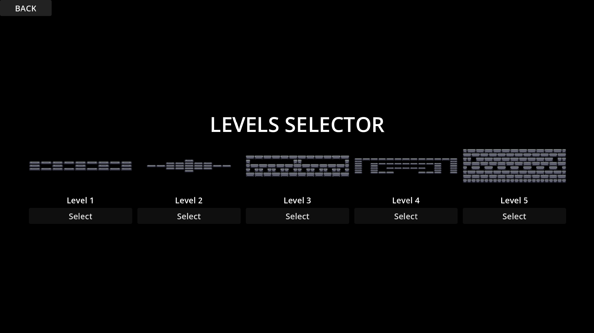
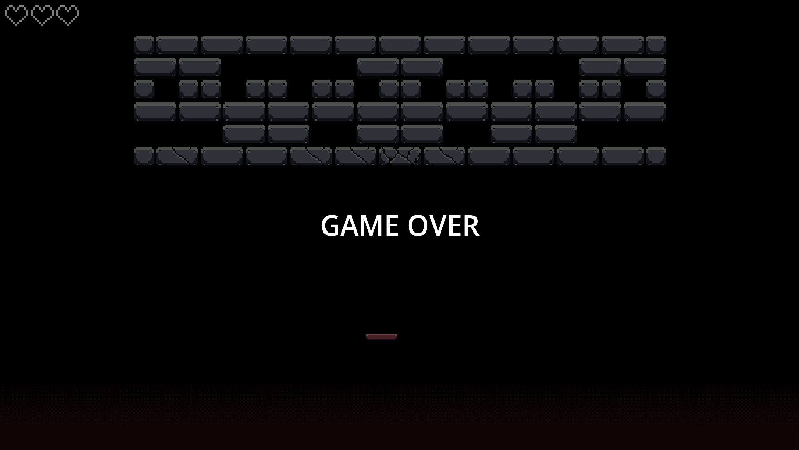

# Breakout

Petit clone de Breakout fait avec **Godot 4**, pour s'entraîner sur les bases du moteur : scènes, physique 2D, collisions, signaux.

## Screenshots

<p align="center">
  
</p>

<table align="center">
  <tr>
    <td align="center"><br><sub>Niveau</sub></td>
    <td align="center"><br><sub>Power-ups</sub></td>
    <td align="center"><br><sub>Sélection de niveau</sub></td>
  </tr>
  <tr>
    <td align="center"><br><sub>Choix du skin</sub></td>
    <td align="center"><br><sub>Victoire</sub></td>
    <td align="center"><br><sub>Défaite</sub></td>
  </tr>
</table>

## Contrôles

| Action | Touche |
|---|---|
| Déplacer le paddle | ← / → |

## Structure

```
res://
├── main/          # scène racine : murs, paddle, balle, chargement des niveaux, UI
├── entities/
│   ├── paddle/
│   ├── ball/
│   ├── brick/
│   └── powerup/
├── levels/        # un niveau = une disposition de briques
├── ui/            # HUD, menus
└── shared/        # sprites, sons, polices
```

## Roadmap

- [x] Paddle
- [x] Murs
- [x] Balle (rebond selon la position sur le paddle)
- [X] Briques
- [X] Premier niveau
- [X] Zone de mort + vies
- [ ] Score + HUD
- [ ] Victoire / défaite
- [ ] Power-ups
- [ ] Menu de sélection de niveau/Niveaux supplémentaires
- [ ] Sons, particules, screen shake
- [ ] Check les private (fonctions, variables)
- [ ] Améliorer l'ui
- [ ] Commenter

## Lancer le projet

Ouvrir le dossier dans Godot 4 et lancer avec **F5**.
